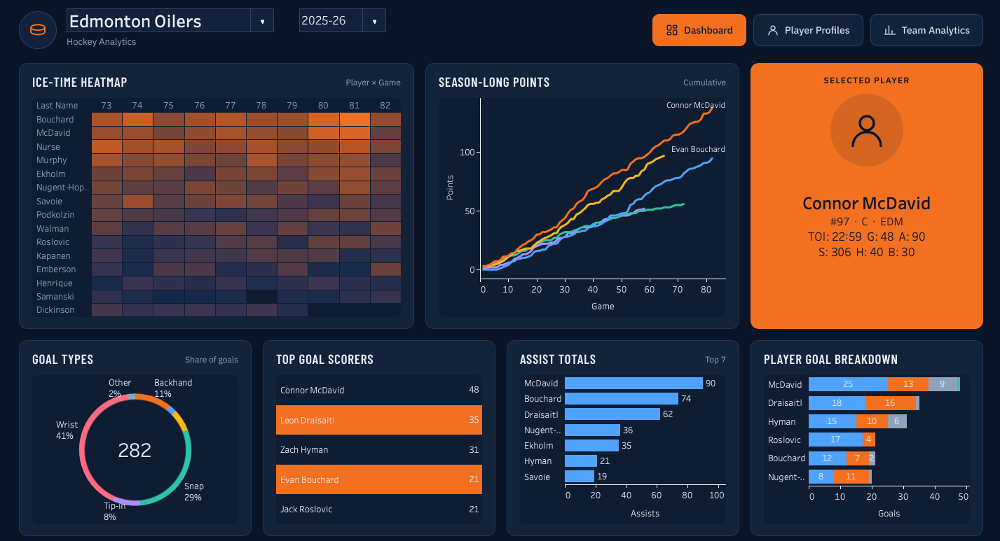
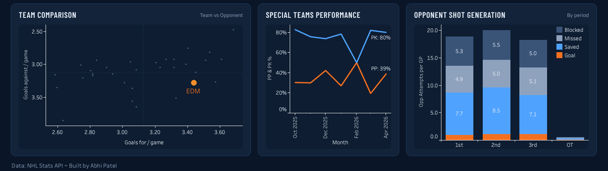
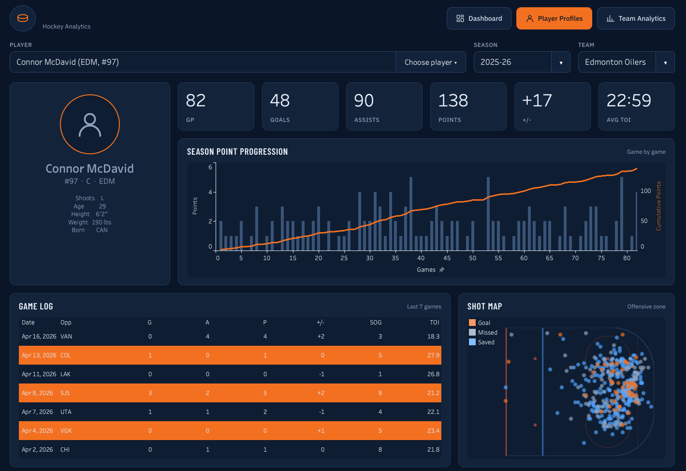
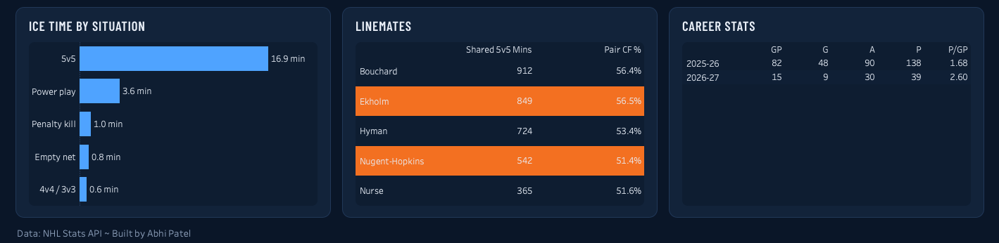
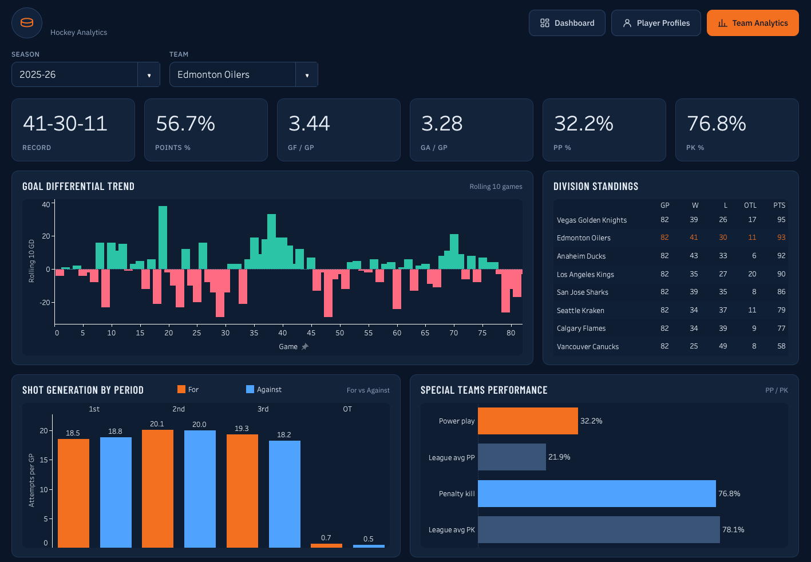
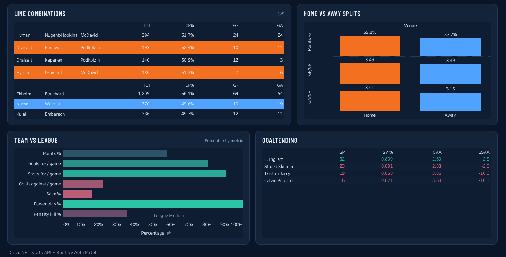

# NHL Hockey Analytics

An interactive three-page Tableau dashboard covering every NHL regular-season game, built on a Python pipeline that pulls box scores, play-by-play, shift charts, standings and rosters from the public NHL API and models them into a star schema.

**▶ Live dashboard:** [Tableau Public link](https://public.tableau.com/views/NHL_Hockey_Analytics_Dashboard/PlayerProfiles?:language=en-US&publish=yes&:sid=&:redirect=auth&:display_count=n&:origin=viz_share_link)

### Dashboard


<details>
<summary><b>Player Profiles</b> (click to expand)</summary>
<br>

</details>

<details>
<summary><b>Team Analytics</b> (click to expand)</summary>
<br>

</details>

---

## What it shows

**Dashboard.** A team at a glance: an ice-time heatmap for the last 10 games, season point races, goals by shot type and by strength, top scorers, special teams by month, opponent shots by period, and a league scatter of goals for vs. against with the selected team highlighted. Clicking a player in the heatmap or scorers table selects them everywhere.

**Player Profiles.** Pick any player from a roster filtered to the chosen team. You get a bio card, season KPIs, game-by-game point progression, a game log, a shot map on a rink diagram, ice time by situation (5v5, PP, PK…), most frequent 5v5 linemates with shot share, and career stats.

**Team Analytics.** Record and KPI tiles, a rolling 10-game goal differential, division standings, shots for/against by period, power play and penalty kill vs. league average, top forward lines and defence pairs, home/away splits, a percentile ranking against all 32 teams, and goaltending (SV%, GAA, GSAA).

Season and team pickers on every page; switch to any team and any loaded season, including the **in-progress 2026-27 season**.

## How it works

```
NHL API  (box scores · play-by-play · shift charts · standings · rosters)
   │
   │  01_fetch.py              cached, resumable download → data/raw/  (JSON)
   ▼
   │  02_build_tables.py       dimensions + game/shot facts → data/clean/  (CSV)
   │  03_build_shift_tables.py on-ice, linemates and line combos from shift charts
   │  04_make_rink.py          rink image for the shot map
   ▼
Tableau  (8 data sources, shared parameters, LOD + table calcs, designed page backgrounds)
```

**Stack:** Python (pandas, NumPy, requests, matplotlib) · Tableau Public · NHL Stats API

### Data model

| Table | Grain |
|---|---|
| `dim_season`, `dim_team`, `dim_player`, `dim_game` | one row per season / team / player / game |
| `fact_team_game` | team × game: result, goals, shots, power play and penalty kill |
| `fact_skater_game` | skater × game: G, A, PTS, +/-, shots, hits, blocks, TOI |
| `fact_goalie_game` | goalie × game: shots, saves, GA, TOI |
| `fact_shot` | every shot attempt: coordinates normalised so the team always attacks right, distance, angle, strength |
| `fact_skater_toi_strength` | skater × game × strength state: ice time |
| `fact_skater_onice_5v5` | skater × game: 5v5 TOI and shot attempts / goals for and against while on ice |
| `fact_linemate` | teammate pair × game: shared 5v5 TOI and shot share |
| `fact_line_combo` | forward trio / defence pair × game: 5v5 TOI, CF, CA, GF, GA |
| `standings` | team × season standings |

## Run it

```bash
python -m venv .venv
source .venv/bin/activate          # Windows: .venv\Scripts\activate
pip install -r requirements.txt

python scripts/01_fetch.py --team EDM --limit 5   # smoke test: about a minute
python scripts/01_fetch.py                        # every season in config.py (~30-40 min per season, first run only)
python scripts/02_build_tables.py
python scripts/03_build_shift_tables.py
python scripts/04_make_rink.py
```

Seasons are set in `scripts/config.py`. The fetch is cached and resumable: rerun it after a crash and it skips everything already downloaded. A season still in progress automatically re-downloads its schedules, standings and rosters on every run, so **rerunning steps 1–3 picks up new games**. Then refresh the extracts in Tableau.

## Design decisions

- **Cache-first fetching.** About 4,000 requests per season to a free, undocumented API. Every response is cached to disk, so the pipeline is resumable and transforms can be re-run without touching the API.
- **Coordinates normalised per period.** Teams switch ends each period. Using `homeTeamDefendingSide`, every shot is flipped so the attacking net is always at +x, which makes a single shot map possible.
- **On-ice from shift charts, second by second.** Each team becomes a boolean matrix `[player, second]`. Linemate pairs are one matrix product (`M @ M.T` gives shared seconds for every pair at once), and line combos group seconds by a bitmask of who was on the ice.
- **Events attributed to `second − 1`.** A shift that ends on a goal is recorded as ending at that same second, so looking one second back credits the players who were actually on the ice.
- **One strength definition, two sources.** Play-by-play `situationCode` for events and shift-derived skater counts for ice time, both using the same precedence rules (empty net › extra attacker › PP/SH › even).
- **Dependent pickers in Tableau.** Tableau can't filter one parameter's list by another, so the player picker is a roster sheet filtered by team, wired to parameter actions that set the player *and* team together. They can never disagree.
- **Rank first, filter after.** The "vs league" percentiles use `RANK_PERCENTILE` across all 32 teams with a `LOOKUP`-based table-calc filter, so the ranking runs before the view narrows to one team. Top-N charts use context filters for the same reason.

## Data notes

- **CF% (shot-attempt share) and GSAA** stand in for xGF% and GSAx, since expected-goals values aren't in the public data.
- **Power-play opportunities** are counted as transitions into a man advantage, a close approximation of the official count.
- **Blocked shots** are excluded from the shot map: the API records where the shot was blocked rather than where it was taken, and has no shot type for them.
- **Player labels** use each player's most recent team, so a player traded mid-season shows his current club.

---

Data: NHL Stats API (`api-web.nhle.com`, `api.nhle.com/stats`), an unofficial public API, used for a non-commercial portfolio project. Built by Abhi Patel.
